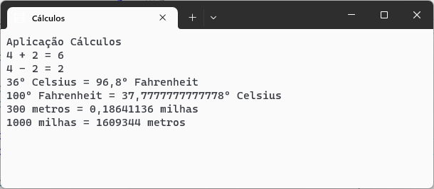

# Cálculos :1234:

Aplicação em C# para efetuar diversos tipos de cálculos.

Desenvolvida no âmbito da ação de formação **Introdução ao git e Github**

## Operações suportadas
Neste momento esta aplicação implementa as seguintes operações:

- soma
- subtração
- conversão de temperaturas
    - celcius :arrow_right: fahrenheit
    - fahrenheit :arrow_right: celcius
- conversão de distâncias:
    - metros :arrow_right: milhas
    - milhas :arrow_right: metros

## Tecnologias utilizadas neste projeto

- Visual Studio
- C#
- Git
- GitHub Desktop
- Plataforma GitHub

